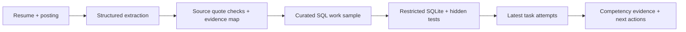

# GapMap presentation kit

## Positioning

**GapMap turns one internship posting into a plan to build evidence of the skills it asks for.**

Lead with the student's decision: “What should I build next, and what would count as evidence?” The centerpiece is the transition from an incorrect work sample to a measured result and a changed roadmap.

## Three-minute speaking script

Follow the matching click sequence in `walkthrough.md`. Speak naturally; the script leaves time for query pastes and page changes.

**0:00–0:20 — Problem**

“A student can add ‘SQL’ to a resume in five seconds. But can they fix a revenue report that double-counts refunds? GapMap helps students find what a specific internship asks for, test relevant skills, and decide what to build next.”

**0:20–0:45 — Inputs**

“Meet Maya, our fictional demo student. She has Python project experience, but no SQL claim. We compare her resume with this internship posting. For a repeatable demo, extraction uses a labeled fixture. The SQL you are about to see actually runs.”

**0:45–1:05 — Traceable evidence**

“Every requirement links back to the employer's words. Python has a self-reported resume claim. SQL has no supporting claim yet. React and Docker are visible too, and we say clearly that our current assessment cannot test them. A missing mention does not mean a missing ability.”

**1:05–1:30 — Work sample**

“GapMap recommends a revenue-debugging investigation. First we connect completed orders to customer regions; then we calculate gross revenue. These two solutions pass, but SQL stays partial because another required assessment is still outstanding.”

**1:30–2:05 — Failure, then correction**

“This refund query looks plausible. But joining each refund directly repeats an order's revenue when it has several refunds. The hidden tests catch that. We aggregate refunds per order first, submit again, and earn the remaining forty points. Tests determine the result.”

**2:05–2:30 — Outcome**

“Now the project is one hundred out of one hundred, and SQL is demonstrated on this work sample. React and Docker remain unverified. The roadmap moves on to those gaps. Maya leaves with a concrete result and a next action.”

**2:30–2:50 — Engineering and learning**

“We combined career preparation, assessment design, and financial reconciliation. AI extracts requirements; source checks ground the quotes; a restricted SQLite engine runs queries. During testing we found that early tasks could mark SQL complete too soon. We corrected the aggregation and added a regression test.”

**2:50–3:00 — Close**

“Built in a twenty-four-hour hackathon, GapMap turns ‘I need this skill’ into ‘here is the next piece of evidence I can build.’”

## Rubric evidence

| Criterion from the supplied rubric | Show or explain | Evidence still missing |
| --- | --- | --- |
| Innovation | Connect a posting quote to a work sample and then to changed next actions. Compare the approaches below honestly. | No proof that this combination is unique or better than established tools. |
| Curiosity | Ask “Does a keyword show usage?” and “Can passing one task establish a competency shared across tasks?” Show contextual evidence checks and the incomplete-assessment regression. | No user study yet. |
| Communication | Demonstrate one complete student journey. Show the before/after screenshots and architecture diagram. | Rehearse pacing and legibility. |
| Breadth and complexity | Explain the combination of career guidance, formative feedback, finance rules, source-grounded extraction, and restricted query execution. | Do not describe this as psychometrically validated or production scale. |
| Impact | A student can identify a relevant gap, try a work sample, and choose a specific next project. | No users, testimonials, placement outcomes, or measured time savings yet. |
| Navigating challenges | Show the naive refund failure, then describe the actual incomplete-assessment bug and the implemented fix. The scoring bug is a development lesson; the refund case is part of the designed assessment. | No need to invent an earlier product pivot. |

## Existing approaches and our design choice

Desk research checked October 24, 2026. These are product descriptions, not a comparative user study.

| Approach | What its own documentation describes | What that means for our prototype |
| --- | --- | --- |
| [Jobscan Resume Scanner](https://www.jobscan.co/resume-scanner) | Compares a resume with a job description and flags missing keywords and formatting issues. | Document alignment is useful. Our demonstration adds measured work on a mapped requirement and updates the student's next actions. Do not imply Jobscan predicts hiring odds. |
| [CodeSignal Technical Assessments](https://codesignal.com/technical-assessments/) | Uses hands-on, job-relevant technical challenges and real IDE environments to assess applied skills. | Work samples and skill assessment are established approaches. Our scope is a small student preparation loop beginning with the student's chosen posting, with one SQL project. Do not claim we invented work samples or outperform validated assessments. |
| [OPM assessment centers](https://piv.opm.gov/policy-data-oversight/assessment-and-selection/other-assessment-methods/assessment-centers/) | Describes exercises that simulate challenges encountered on the job. | This supports the choice of a financial debugging scenario rather than an isolated syntax quiz. GapMap's single task set has not been validated as a hiring instrument. |

Alternatives considered in the implementation: keyword-only evidence versus contextual claims; model-assigned scores versus deterministic outputs; a broad project generator versus one curated, testable SQL investigation. The code implements contextual evidence checks, deterministic grading, and a fixed assessment. These are design decisions; do not claim an unperformed A/B experiment.

## Architecture to explain in twenty seconds

The recording substitutes the labeled extraction fixture at B. D through G still execute. API keys stay on the server. Sessions currently live in one API process; they reset on restart. The browser saves inputs and drafts locally until Reset session is clicked.

## Likely judge questions

**“How is this different from a resume scanner or coding platform?”**

“Our prototype connects a student's chosen posting, traceable requirements, one relevant work sample, and an updated roadmap. The individual ideas already exist. We are testing whether this short connected workflow helps students choose useful evidence to build.”

**“Could you just ask an LLM to do this?”**

“An LLM can propose requirements and explanations. We verify the source excerpts and use deterministic query outputs for the measured result. A model does not award SQL points.”

**“Is the AI live in this demo?”**

“The extraction is a labeled fixture for reliability. We also have extraction clients for configured providers, but this recording demonstrates the full deterministic assessment path. We do not claim an offline fixture is a live model call.”

**“What does 100/100 prove?”**

“That these submitted solutions passed this project's designated tests. It is scoped to this work sample and does not certify broad SQL mastery, identity, authorship, or employability.”

**“Can someone copy the solutions?”**

“Yes. This is a practice and feedback prototype, not a proctored hiring assessment. Hidden datasets reject memorized sample rows, but do not establish authorship.”

**“Who has used it?”**

“No external users yet; this is a twenty-four-hour prototype. Next we would ask a few students to use it and check whether they can name a relevant gap, interpret a failed test, and select a concrete next action without help.”

**“What happens at ten times the scale?”**

“We would replace in-memory sessions with durable storage, add bounded execution workers and request limits, and expand only with projects whose competencies and tests have been reviewed.”

**“What did you struggle with?”**

“Integration looked correct in isolated tests, but an outstanding task could still leave a shared competency marked complete. A regression test made that failure visible. We changed readiness to require every designated task and made the UI refresh from the server after submissions.”

## The highest-value remaining preparation

If time permits, invite one or two students to try the flow in person. Ask them to explain the difference between a resume claim and tested evidence, and to identify their next action. Record what actually happens and improve one confusing step. A tiny honest observation is more credible than a made-up impact statistic.

Rehearse the exact three-minute path, save a backup recording, and freeze the demo after final checks. Lead with the product outcome; show the stack only when explaining how the evidence can be trusted.
